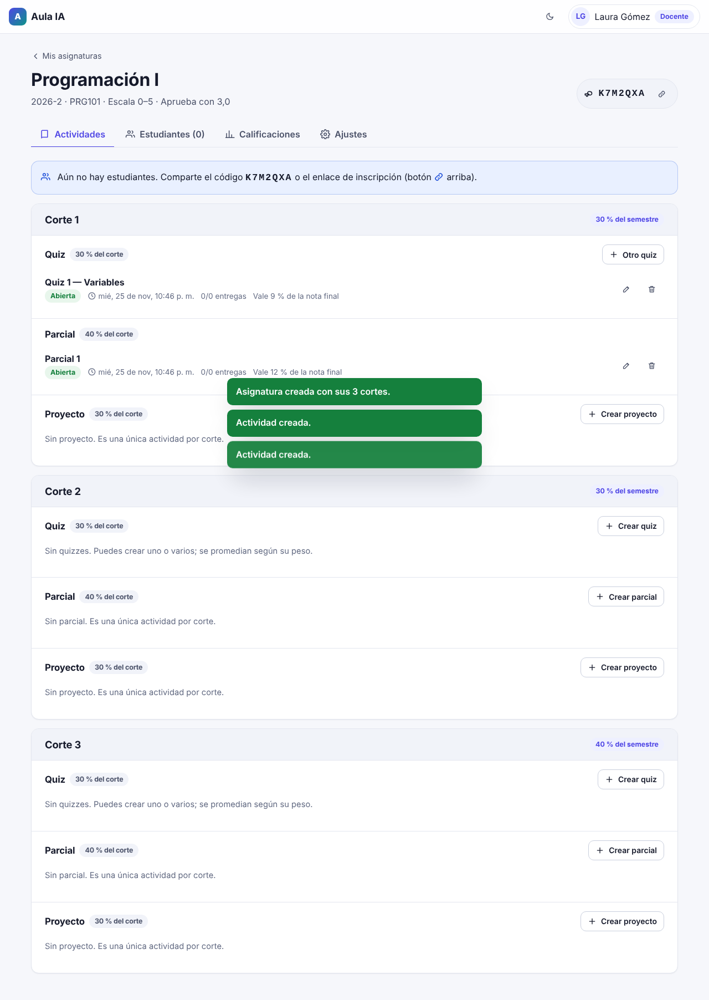
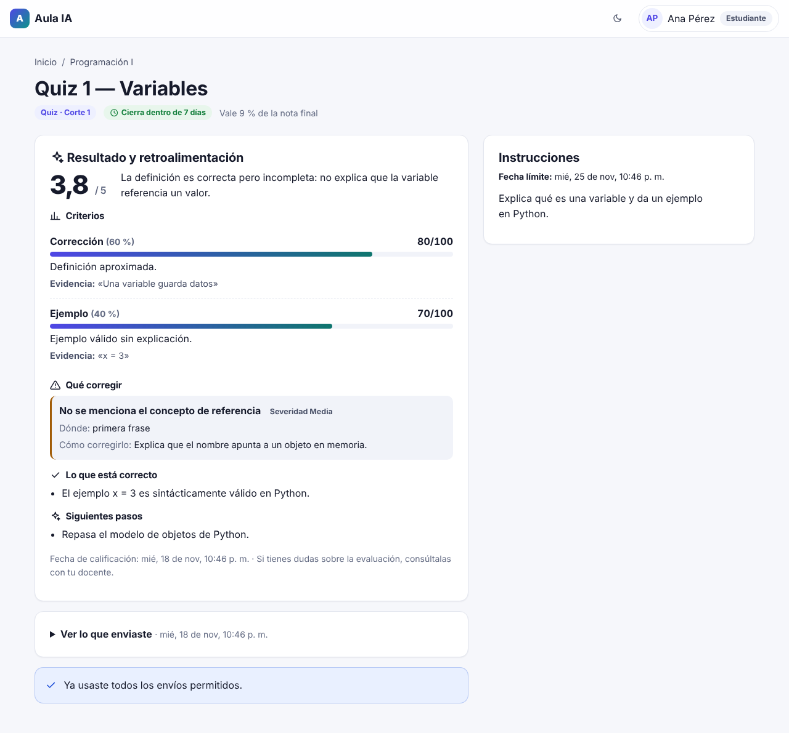
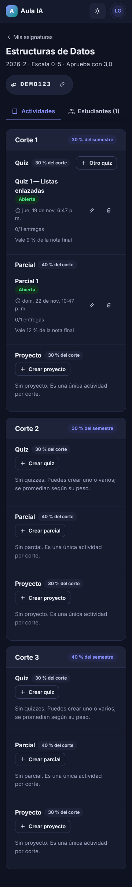

# Aula IA — Plataforma docente con agente evaluador gratuito

Plataforma web para docentes con un **agente de IA que evalúa automáticamente** las entregas de los estudiantes, envía **recordatorios a su Gmail** y genera **reportes de notas en Excel/CSV**. Todo el stack usa planes **gratuitos**.

## Qué hace

**Docente**
- Crea varias asignaturas por semestre. Cada una nace con **3 cortes**, y cada corte tiene **quiz** (una o varias actividades ponderadas), **parcial** (una) y **proyecto** (uno). Los porcentajes son configurables.
- Por actividad escribe el enunciado, adjunta archivos y una rúbrica visible, y define una **solución de referencia privada** (texto o archivo) más indicaciones privadas para el agente.
- Revisa, ajusta o aprueba las notas de la IA, califica a mano si hace falta y pide reevaluar una entrega.
- Descarga **Excel o CSV por corte** y el **historial completo del semestre** (resumen, 3 cortes, detalle por entrega y configuración).
- Al cerrar el semestre **borra la asignatura**, pero solo si descargó el historial después del último cambio de notas y escribe el nombre para confirmar.

**Estudiante**
- Entra con Google y se inscribe con un código o un enlace.
- Entrega texto o archivo: PDF, imagen, Word, código, .zip o cuaderno Jupyter.
- Recibe una retroalimentación objetiva: criterios con evidencia, qué corregir y cómo, y siguientes pasos.
- Ve su nota acumulada y el porcentaje del semestre ya evaluado.

**Agente (cada 10 min, en GitHub Actions)**
- Evalúa con Gemini, con Groq como respaldo, siguiendo la skill [`evaluador-objetivo`](agent/skills/evaluador-objetivo/SKILL.md).
- La nota la calcula el código a partir de los criterios, no el modelo.
- Manda a revisión del docente las evaluaciones de baja confianza, los intentos de manipulación y los archivos ilegibles.
- Envía por correo:
  - **recordatorios** a las 72 h, 24 h y 3 h del cierre, solo a quien no ha entregado;
  - **aviso de actividad nueva**;
  - **aviso de retroalimentación lista**;
  - un **resumen diario al docente** con lo pendiente de revisar.
- No envía nombre, correo ni ID del estudiante al modelo de IA.

## Capturas

| Docente: actividades por corte | Estudiante: retroalimentación | Móvil (tema oscuro) |
|---|---|---|
|  |  |  |

## Arquitectura

| Pieza | Servicio gratuito | Carpeta |
|---|---|---|
| Base de datos, login con Google, archivos | Supabase Free | `supabase/` |
| Web adaptativa (sin compilación) | GitHub Pages | `web/` |
| Agente evaluador y correos | GitHub Actions + Gemini API + Gmail SMTP | `agent/`, `.github/workflows/agente.yml` |
| Conector MCP para el docente (opcional) | Tu computador | `mcp/` |

Detalles, contrato de datos y límites de cada servicio en [docs/ARQUITECTURA.md](docs/ARQUITECTURA.md).

---

## Despliegue paso a paso (≈ 45 minutos)

Necesitas: una cuenta de GitHub, una cuenta de Google para la consola de Google Cloud y AI Studio, y una cuenta de Gmail para enviar los avisos. Se recomienda crear una cuenta dedicada, p. ej. `aula.avisos@gmail.com`.

### 1. Supabase (base de datos y login)
1. Crea un proyecto en <https://supabase.com> (plan Free). Elige la región **South America (São Paulo)**, la más cercana a Colombia.
2. Abre **SQL Editor → New query**, pega todo `supabase/schema.sql` y pulsa **Run**. Debe terminar sin errores.
3. En el mismo editor autoriza tu correo como docente:
   ```sql
   insert into public.teacher_allowlist (email) values ('tu.correo@gmail.com');
   ```
   Repite esta línea por cada docente. Cualquier otra cuenta entra como estudiante.
4. En **Project Settings → API Keys** copia:
   - la **Project URL**;
   - la **clave publicable** (`sb_publishable_…`), que va en la web;
   - la **clave secreta** (`sb_secret_…`), que va solo en GitHub.

   Si tu proyecto solo muestra claves heredadas, `anon` y `service_role` también funcionan, pero Supabase las retira a finales de 2026.

### 2. Login con Google
1. En <https://console.cloud.google.com> crea un proyecto.
2. Ve a **APIs y servicios → Pantalla de consentimiento de OAuth**:
   - tipo *Externo*;
   - nombre de la app y correo de soporte;
   - publícala (**En producción**). Con los permisos básicos `email` y `profile` no requiere verificación de Google.
3. En **Credenciales → Crear credenciales → ID de cliente de OAuth → Aplicación web**:
   - *Orígenes de JavaScript autorizados*: `https://TU-USUARIO.github.io`
   - *URI de redireccionamiento autorizados*: `https://TU-PROYECTO.supabase.co/auth/v1/callback`
4. Copia el *Client ID* y el *Client secret*. En Supabase ve a **Authentication → Sign In / Providers → Google**, actívalo y pégalos.
5. En **Authentication → Sign In / Providers → Email**, **desactiva** el proveedor Email para que solo se entre con Google. Si lo dejas activo, mantén «Confirm email» encendido: el rol docente exige correo confirmado.
6. En Supabase ve a **Authentication → URL Configuration**:
   - **Site URL**: `https://TU-USUARIO.github.io/TU-REPO/`
   - **Redirect URLs**: añade esa misma URL (y `http://localhost:8080/` si vas a probar en local).

### 3. Clave de IA gratuita
1. En <https://aistudio.google.com> pulsa **Get API key → Create API key**, sin tarjeta.
2. Opcional, como respaldo: crea una clave gratuita en <https://console.groq.com>. Sirve para entregas de texto o código si Gemini alcanza su límite.

> **Privacidad**: en el plan gratuito, Google puede usar el contenido enviado para mejorar sus productos. El agente nunca envía datos personales del estudiante, pero sí el contenido de la entrega. Informa a tus estudiantes (Ley 1581 de 2012). Para evitarlo, usa `LLM_PROVIDERS=groq,gemini` o activa facturación en Gemini.

### 4. Gmail para los avisos
1. En la cuenta de Gmail que enviará los avisos activa la **verificación en 2 pasos**.
2. Ve a <https://myaccount.google.com/apppasswords>, crea una **contraseña de aplicación** ("Aula IA") y copia los 16 caracteres.
3. Límite: 500 destinatarios por día. El agente se detiene en 450 por defecto.

### 5. GitHub (web y agente)
1. Crea un repositorio **público**: los minutos de Actions son ilimitados en repos públicos y el código no contiene secretos.
2. Edita `web/config.js` con tu Project URL y la clave **publicable**, y sube todo el proyecto a la rama `main`.
3. En **Settings → Pages → Source** elige **GitHub Actions**. El flujo `web` publica el sitio en `https://TU-USUARIO.github.io/TU-REPO/`.
4. En **Settings → Secrets and variables → Actions → Secrets** crea:

   | Secreto | Valor |
   |---|---|
   | `SUPABASE_URL` | Project URL |
   | `SUPABASE_SERVICE_ROLE_KEY` | Clave **secreta** `sb_secret_…` (o `service_role` heredada) |
   | `GEMINI_API_KEY` | Clave de AI Studio |
   | `GROQ_API_KEY` | (opcional) clave de Groq |
   | `GMAIL_USER` | Correo que envía los avisos |
   | `GMAIL_APP_PASSWORD` | Contraseña de aplicación (16 caracteres) |

5. En la pestaña **Variables** crea `APP_URL` = `https://TU-USUARIO.github.io/TU-REPO/`, para que los correos tengan enlace. Las demás variables son opcionales; ver `agent/README.md`.
6. Ve a **Actions → agente → Run workflow** para la primera ejecución. Revisa el registro: debe decir cuántas entregas evaluó y cuántos correos envió. Si quieres probar sin enviar correos, crea antes la variable `DRY_RUN=true`.

### 6. Primer uso
1. Entra a la web con tu cuenta autorizada: verás **Mis asignaturas**.
2. Crea una asignatura y una actividad con solución de referencia.
3. Comparte el código o el enlace de inscripción.
4. Entrega una prueba con otra cuenta de Google. En 10 a 20 minutos el agente la evalúa.

---

## Pruebas (evidencia en [docs/VERIFICACION.md](docs/VERIFICACION.md))

```bash
supabase/tests/run.sh                             # Postgres real: RLS, RPC, cola, notificaciones, borrado
cd agent && node --test test/*.test.js            # agente: archivos, LLM, evaluación, correos
cd mcp && node --test test/*.test.mjs             # servidor MCP
cd web && node --test test/*.test.mjs             # notas, Excel/CSV, cliente Supabase
cd web && node test/e2e/run.mjs                   # flujo completo en Chrome headless (requiere Playwright)
```

Para probar la web en local: `cd web && python3 -m http.server 8080` y abre `http://localhost:8080/`.

## Problemas frecuentes
Ver [docs/DEPURACION.md](docs/DEPURACION.md): procedimiento sistemático síntoma → hipótesis → comprobación → corrección para login, evaluación, correos, cron y reportes.

## Estructura

```
supabase/schema.sql          Esquema, RLS, RPC y Storage (ejecutar una vez)
supabase/tests/              Pruebas en Postgres real
web/                         Web estática (HTML/CSS/JS modular, sin dependencias)
agent/                       Agente evaluador (Node 22) + skill evaluador-objetivo
mcp/                         Servidor MCP para consultar y calificar desde Claude u otro cliente MCP
.github/workflows/           agente.yml (cada 10 min) y web.yml (GitHub Pages)
.claude/skills/              Skill del evaluador para Claude Code
docs/                        Arquitectura, plan, verificación y depuración
```
