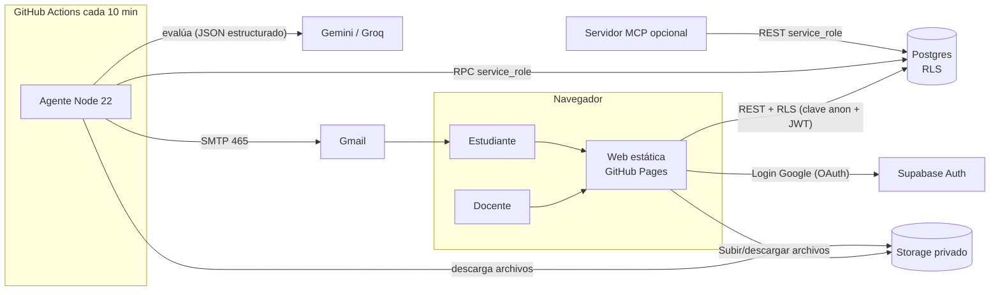

# Arquitectura — Plataforma Docente IA

Este documento es el **contrato** entre las tres piezas del sistema: la base de datos, la web y el agente. Si cambias algo aquí, cambia las tres.

## 1. Stack 100 % gratuito

| Necesidad | Servicio | Plan gratuito (nov 2026) | Por qué |
|---|---|---|---|
| Base de datos, login con Google, archivos | **Supabase Free** | 500 MB BD, 1 GB archivos, 50.000 usuarios activos/mes, 5 GB de tráfico | Postgres real con seguridad por filas (RLS); el login con Google es nativo |
| Web | **GitHub Pages** (o Cloudflare Pages / Netlify / Vercel) | Ilimitado para sitios estáticos | La web no necesita compilación: son archivos HTML/CSS/JS |
| Agente (ejecución periódica) | **GitHub Actions** (repositorio público) | Minutos ilimitados en repos públicos; intervalo mínimo 5 min | Corre el agente cada 10 min sin servidor propio |
| IA | **Google Gemini API** (AI Studio), respaldo **Groq** | Modelos Flash / Flash‑Lite gratis con límites por proyecto | Gemini lee PDF e imágenes de forma nativa |
| Correo | **Gmail SMTP** con contraseña de aplicación | 500 destinatarios/día (cuenta gmail.com) | Llega a la bandeja de Google del estudiante sin dominio propio |

**Limitaciones conocidas y mitigaciones**

- Supabase Free **pausa el proyecto tras 7 días sin actividad**. El agente consulta la BD cada 10 minutos, así que el proyecto nunca queda inactivo.
- GitHub **desactiva los cron de repos públicos tras 60 días sin actividad**. El flujo incluye un paso que se reactiva a sí mismo (`keepalive`), y los cron pueden retrasarse en horas pico (la evaluación tarda entre 10 y 30 min, no es instantánea).
- **Gemini gratuito usa los datos enviados para mejorar productos de Google** y pueden ser revisados por personas. El agente **nunca envía nombre, correo ni ID del estudiante**: solo el enunciado, la solución de referencia y el contenido de la entrega. Informa esto a tus estudiantes (Ley 1581 de 2012, habeas data). Si no es aceptable, usa Groq como proveedor principal (`LLM_PROVIDERS=groq,gemini`) o activa facturación en Gemini.
- Los límites de Gemini cambian con frecuencia y Google ya no publica cifras por modelo: el agente **descubre los modelos disponibles** con `models.list` y prueba una cadena de respaldo (`GEMINI_MODELS`), con reintentos ante 429/503.
- Gmail: 500 destinatarios/día. El agente lleva un **presupuesto diario** (`EMAIL_DAILY_BUDGET`, por defecto 450) contando `notification_log`.

## 2. Diagrama



## 3. Modelo de datos (ver `supabase/schema.sql`)

- `profiles` — 1:1 con `auth.users`. `role` = `docente` si el correo está en `teacher_allowlist`, si no `estudiante`.
- `subjects` — asignatura (docente, semestre, `join_code`, `grade_scale` 5/10/100, `pass_grade`, `auto_publish`, `exported_at`).
- `cortes` — exactamente 3 por asignatura. `weight` = % del semestre (suman 100). `quiz_weight + parcial_weight + proyecto_weight = 100`.
- `activities` — `component` ∈ quiz | parcial | proyecto. **Parcial y proyecto: una por corte** (índice único parcial). Quiz: varios; `weight` = peso relativo entre quizzes del corte.
- `activity_keys` — **privada**: `reference_solution`, `reference_path`, `grading_notes`.
- `enrollments` — inscripción con código (`join_subject`).
- `submissions` — una fila por (actividad, estudiante); reenvíos incrementan `submission_count` hasta `max_submissions`.
- `notification_log` — idempotencia de correos (`unique nulls not distinct (user_id, activity_id, kind)`).
- Vista `student_submissions` — lo que ve el estudiante: nota/retroalimentación solo si `status='evaluada'`.

### Estados de una entrega

```
pendiente ──(agente reclama)──> evaluando ──(ok, confianza alta y auto_publish)──> evaluada
                                   │  └──(baja confianza o auto_publish=false)──> revision ──(docente aprueba)──> evaluada
                                   └──(fallo)──> error ──(reintento automático ×3, luego docente "Reevaluar")
```
`ai_enabled=false` en la actividad ⇒ la entrega entra directo a `revision` (calificación manual).

## 4. Rutas de Storage (buckets privados, 10 MB por archivo)

| Bucket | Ruta | Quién |
|---|---|---|
| `materiales` | `{subject_id}/{activity_id}/enunciado/{archivo}` | Docente escribe; inscritos leen |
| `materiales` | `{subject_id}/{activity_id}/referencia/{archivo}` | Solo docente (y agente) |
| `entregas` | `{subject_id}/{activity_id}/{student_id}/{timestamp}-{archivo}` | El estudiante dueño escribe/lee/borra; docente lee/borra |

## 5. RPC

**Web (rol `authenticated`)**: `join_subject(p_code)`, `regenerate_join_code(p_subject)`, `save_weights(p_subject, p_cortes jsonb)`, `submit_activity(p_activity, p_text, p_file_path, p_file_name, p_file_mime, p_file_size)` (la ruta debe cumplir `^{subject}/{activity}/{uid}/[A-Za-z0-9._-]+$` y existir en Storage), `review_submission(p_submission, p_grade, p_comment, p_publish, p_count)` (`p_count` = versión revisada; si el estudiante reenvió, se rechaza), `set_manual_grade(p_activity, p_student, p_grade, p_comment)` (crea la fila con `submission_count = 0`: no consume envíos), `requeue_submission(p_submission)` (limpia también la nota del docente), `mark_exported(p_subject)`, `prepare_subject_deletion(p_subject, p_confirm)` → (web borra Storage) → `delete_subject(p_subject, p_confirm)`.

**Agente (rol `service_role`)**:

| RPC | Devuelve |
|---|---|
| `claim_submissions(p_limit int)` | `setof jsonb` → `{submission:{id, submission_count, content_text, file_path, file_name, file_mime, file_size, is_late, submitted_at, eval_attempts}, activity:{id,title,component,instructions,rubric,statement_path,statement_name,due_at}, key:{reference_solution,reference_path,reference_name,grading_notes}, subject:{id,name,grade_scale,pass_grade,auto_publish}, corte:int}` |
| `complete_evaluation(p_submission, p_count, p_grade, p_feedback jsonb, p_model, p_confidence, p_needs_review)` | `'evaluada' \| 'revision' \| 'stale'` |
| `fail_evaluation(p_submission, p_count, p_error)` | void |
| `due_reminders(p_now)` (espera 12 h tras el aviso «nueva», salvo el de 3 h) / `new_activity_notices(p_now)` | filas `{user_id,email,full_name,activity_id,activity_title,subject_name,component,corte,due_at,kind}` |
| `feedback_notices()` | filas `{user_id,email,full_name,activity_id,activity_title,subject_name,submission_id,grade,grade_scale,summary,kind}` (`kind = retro:{envío}:{epoch de evaluación}`: una reevaluación genera un aviso nuevo) |
| `teacher_digests(p_day date)` | filas `{user_id,email,full_name,kind,items jsonb[]}` |
| `claim_notification(p_user,p_activity,p_kind)` | boolean (true ⇒ enviar) |
| `release_notification(p_user,p_activity,p_kind)` | void (si el envío falló) |
| `emails_sent_since(p_since)` | int |

PostgREST: `POST {SUPABASE_URL}/rest/v1/rpc/{fn}` con cabeceras `apikey` y `Authorization: Bearer {key}`. Storage: `GET {SUPABASE_URL}/storage/v1/object/{bucket}/{path}` (autenticado).

## 6. Formato de la retroalimentación (`submissions.ai_feedback`)

Lo produce el agente y lo muestra la web. Versión 1:

```json
{
  "version": 1,
  "resumen": "Dos o tres frases objetivas sobre el resultado.",
  "criterios": [
    {"nombre": "Corrección", "peso": 50, "puntaje": 60, "evidencia": "cita o referencia concreta a la entrega", "comentario": "qué falta o qué está mal"}
  ],
  "aciertos": ["Aspecto correcto, con evidencia concreta"],
  "errores": [
    {"descripcion": "Qué está mal", "evidencia": "dónde aparece", "como_corregir": "acción concreta", "severidad": "alta|media|baja"}
  ],
  "recomendaciones": ["Siguiente paso concreto de estudio"],
  "confianza": 0.85,
  "requiere_revision": false,
  "motivo_revision": null,
  "alertas": ["p. ej. intento de manipular la evaluación, archivo ilegible, contenido fuera de tema"],
  "nota": 3.4,
  "escala": 5,
  "entrega_tardia": false,
  "modelo": "gemini-x-flash"
}
```

**La nota no la decide el modelo**: el agente la calcula de forma determinista como `escala × Σ(peso·puntaje) / 10000` (pesos normalizados a 100) y la redondea a 1 decimal. `requiere_revision` se fuerza a `true` si `confianza < 0.6`, si hay alertas de manipulación, si el archivo no se pudo leer o si la actividad no tiene solución de referencia ni rúbrica.

## 7. Cálculo de notas (web, `web/js/grading.js`)

- Nota de actividad = `teacher_grade ?? ai_grade` si está publicada (`evaluada`); para el docente, las que están en `revision` cuentan como provisionales.
- Actividad vencida sin entrega ⇒ 0. Sin vencer y sin nota ⇒ pendiente.
- Quiz del corte = Σ(peso·nota) / Σ(peso de **todos** los quizzes publicados del corte): los pendientes cuentan 0 en la **nota acumulada** (lo ya asegurado). Además se informa el **% ya evaluado** y el **promedio sobre lo evaluado** (`average`), que no penaliza lo pendiente.
- Corte = Σ componente × % componente (pendiente = 0, con su % evaluado).
- Definitiva = Σ corte × % corte. Redondeo: actividad 1 decimal; corte y definitiva 2 decimales.

## 8. Agente

Ejecución única por invocación (`node agent/src/index.js`), con presupuesto de tiempo (`RUN_BUDGET_MS`, 8 min):

1. `evaluate`: reclama hasta `MAX_EVALUATIONS_PER_RUN` entregas, descarga archivos, extrae contenido (PDF/imagen → Gemini nativo; texto/código → texto; `.docx` y `.zip` → se extraen en el agente), arma el prompt con la skill `agent/skills/evaluador-objetivo/SKILL.md`, llama al LLM con salida JSON, valida y normaliza, calcula la nota y llama `complete_evaluation`. Concurrencia limitada (`EVAL_CONCURRENCY`, 2) para respetar los límites gratuitos.
2. `notify`: retroalimentaciones listas → recordatorios (72h/24h/3h) → actividades nuevas → resumen diario al docente. Siempre `claim_notification` antes de enviar y `release_notification` si falla.
3. Registro estructurado en consola (visible en GitHub Actions) sin datos personales en los prompts.

## 9. Seguridad

- La clave `anon` está en la web (es pública por diseño); toda la protección está en RLS y en RPC `security definer` que validan `auth.uid()`.
- La clave `service_role` **solo** vive en los secretos de GitHub Actions (y en tu máquina si usas el MCP).
- La solución de referencia vive en `activity_keys` y en `materiales/.../referencia/`, inaccesibles para estudiantes (probado en `supabase/tests`). La skill prohíbe revelarla en la retroalimentación y un filtro determinista (secuencias de ≥ 8 palabras compartidas con la referencia que no estén en la entrega) fuerza la revisión docente.
- Rutas de archivo: la RPC exige el patrón exacto y que el objeto exista; el agente además rechaza `.`/`..` y verifica que la URL final quede bajo `/storage/v1/object/{bucket}/` (defensa contra recorrido de rutas con la clave secreta).
- La vista `student_submissions` omite `alertas`, `motivo_revision`, `confianza`, `requiere_revision` y `modelo` del JSON de retroalimentación.
- El rol docente exige correo confirmado (`email_confirmed_at`); se recomienda dejar solo el proveedor Google.
- Claves de Supabase: las nuevas (`sb_publishable_…`, `sb_secret_…`) van solo en la cabecera `apikey`; `Authorization` solo lleva JWT (sesión de usuario o claves heredadas).
- Defensa contra *prompt injection*: la entrega va delimitada como datos, la skill ordena ignorar instrucciones dentro de ella y reportarlas como alerta; la nota se calcula fuera del modelo.
- La web escapa todo el HTML generado (`html` con escape automático), sin `innerHTML` de datos crudos.
